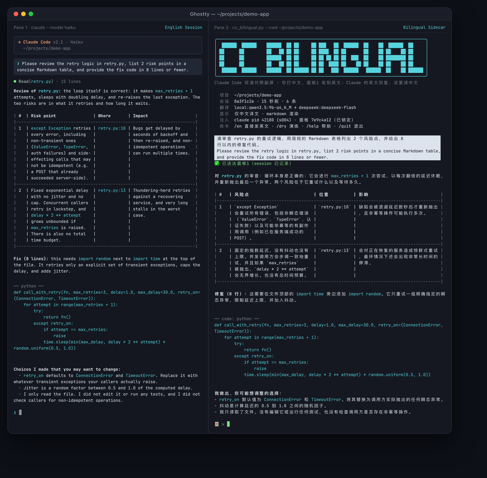
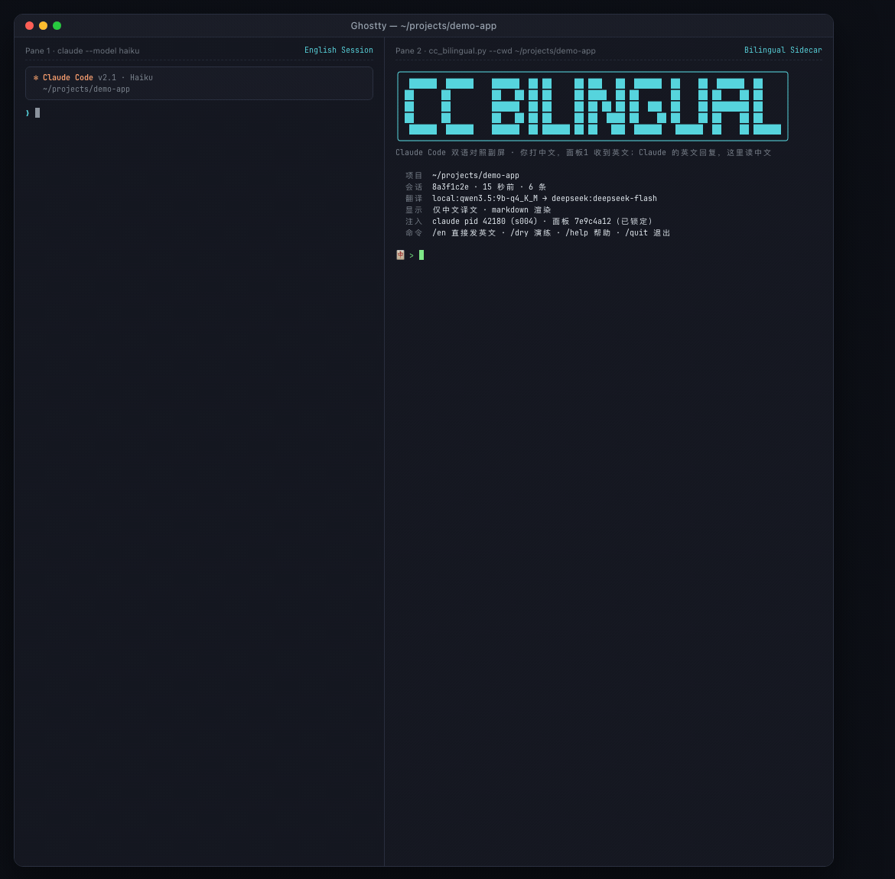

<div align="center">

# ghostty-cc-bilingual

**Zero-dependency bilingual side pane for Claude Code on macOS & Ghostty.**

[](https://ghostty.org)
[](https://www.python.org)
[](LICENSE)

English | [简体中文](README.zh-CN.md)

</div>

Keep **Pane 1** running native English `claude` (stable prompts, lower token overhead, zero binary patching or MITM proxies) while **Pane 2** runs `cc_bilingual.py`: type Chinese (or any native language once you adapt the prompts in `translate.py`), inspect the English translation, inject it into Pane 1 with JSONL read-after-write delivery verification, and read Markdown-rendered Chinese replies side by side.

> **Terminal flexibility:** Bidirectional injection requires **Ghostty 1.3+** on macOS (AppleScript split & input support). However, `--watch-only` works in **any terminal** (`iTerm2`, `WezTerm`, `tmux`, `Terminal.app`) as a read-only translated reply viewer, and the system prompts in `translate.py` can be customized for other language pairs (Japanese, Korean, German, Spanish, etc.).

<p align="center">
  
</p>

```text
┌───────────────────────────┬───────────────────────────────────────┐
│ Pane 1: claude            │ Pane 2: ghostty-cc-bilingual          │
│ (pure English session)    │  🀄 Chinese input                     │
│                           │   ├─ 🇬🇧 English preview (reverse block)│
│                           │   └─ Verified injection → Pane 1      │
│                           │  🤖 Claude reply (from session JSONL) │
│                           │   └─ 🇨🇳 Chinese translation (ANSI MD) │
└───────────────────────────┴───────────────────────────────────────┘
```

## Demo

<p align="center">
  
</p>

<sub>Type Chinese in Pane 2 → inspect the reverse-video English preview → verified Ghostty injection into Pane 1 (<code>claude --model haiku</code>) → real-time ANSI Markdown &amp; CJK-aligned table translation.</sub>

## Features

- **Non-intrusive sidecar architecture** — Never patches Claude Code or intercepts API traffic. Reads `~/.claude/projects/*/*.jsonl` incrementally and injects English via Ghostty AppleScript (`inject.sh`).
- **Deterministic read-after-write verification** — `inject.sh` sends text from a UTF-8 temp file (`do shell script "cat"`), waits (`>= 2s`, default `3s`) before sending `enter`, and polls the session JSONL (recognizing both standard `user` entries and busy-pane `queue-operation/enqueue` records) before marking delivery `✅`.
- **Process ancestry & panel locking guards** — Verifies an interactive `claude` process is running in the target `cwd` inside Ghostty (refusing to inject into `Terminal.app` / `iTerm2` / SSH windows sharing the same cwd). Resolves and locks both the target session (interactive picker when multiple today sessions are close in mtime) and target Ghostty panel UUID at startup (`--terminal` or persisted in `~/.ghostty-cc-bilingual/targets.json`, refusing to auto-lock when no `claude` is running).
- **Structural preservation & tiered bold fidelity** — Masks fenced code blocks, inline code, URLs, and file paths (`@@N@@`) before translation and restores them verbatim afterward. Supports `bold_fidelity`:
  - `fast` (default): single-pass translation (fastest, ~1s short sentences).
  - `balanced`: paragraph-level repair using numbered `【bN】...【/bN】` markers for blocks that dropped `**bold**` markers.
  - `exact`: deterministic segment-by-segment rebuild when placeholders or bold markers are still missing.
- **Prompt-injection-resistant translation** — Example-anchored system prompts plus a runtime guardrail that intercepts abnormally short translations (`len(out) < 0.35 * len(in)` for inputs `>= 15` chars) and asks for confirmation before injecting.
- **Zero-dependency terminal UX** — Pure Python stdlib + POSIX `/bin/sh`. Includes a UTF-8-aware `RawLineEditor` (fixes macOS canonical-mode byte-wise CJK backspace corruption), Bracketed Paste (`CSI ?2004h/l`) for multi-line SQL/code blocks, reverse-video user message blocks, and CJK-width-aware ANSI Markdown & aligned table rendering.
- **Local-first Ollama support & telemetry** — Native Ollama `/api/chat` integration with explicit `think = false` (avoids thinking-model latency spikes) and per-call JSONL telemetry (`~/.ghostty-cc-bilingual/stats.jsonl` + `stats_report.py`).

## Quick Start

Requires **macOS**, **Python 3.12+**, **Ghostty 1.3+** (for injection), and either a local Ollama instance or an OpenAI-compatible / DeepSeek / Gemini API key.

```sh
git clone https://github.com/rockcli/ghostty-cc-bilingual.git ~/tools/ghostty-cc-bilingual

# Option A: Open a right-hand Ghostty split pane from your project directory
cd /path/to/your/project
~/tools/ghostty-cc-bilingual/cc-bilingual-start.sh --launch

# Option B: Manual split (Pane 1 runs `claude`; Pane 2 runs `cc_bilingual.py`)
python3 ~/tools/ghostty-cc-bilingual/cc_bilingual.py --cwd /path/to/your/project
```

Optional shell helper (`~/.zshrc`):

```sh
bilingual() {
    local dir="${PWD}"
    if [ -n "${1:-}" ] && [ -d "${1}" ]; then
        dir="${1}"
        shift
    fi
    python3 "${HOME}/tools/ghostty-cc-bilingual/cc_bilingual.py" --cwd "${dir}" "$@"
}
```

Switch between Ghostty splits with `Cmd+[` / `Cmd+]`.

### Interactive Commands

| Input | Behavior |
|---|---|
| Chinese (contains CJK) | Translate to English → show reverse-video Chinese & English blocks → verify & inject into Pane 1 |
| English (no CJK) | Detected automatically and sent verbatim without calling the translator |
| `/en <text>` | Force verbatim English injection without translation |
| `/dry` | Toggle dry-run mode (preview translation & target check without injecting) |
| `/help` (`/h`) | Show interactive command summary |
| `/quit` (`/q`) | Exit the side pane (Pane 1 session keeps running untouched) |

Multi-line pastes are buffered as a single message via Bracketed Paste (`ESC[200~` / `ESC[201~`) and only submitted when you press `Return` outside the paste.

### CLI Options

- `--cwd PATH` (required): Project working directory matching Pane 1's `claude` session.
- `--session PATH`: Explicitly follow a specific `~/.claude/projects/*/*.jsonl` file.
- `--terminal UUID`: Explicitly target a Ghostty panel UUID (useful when multiple panes share the same `cwd`).
- `--watch-only`: Read-only watcher mode — renders translated replies without accepting input or requiring Ghostty injection (works in any terminal).
- `--no-inject`: Practice mode — translates and displays side-by-side without injecting into Pane 1.
- `--dry`: Run `inject.sh --dry-run` (dry-run only; never injects).
- `--max-chars N`: Override `[display] max_chars` per rendered block.
- `--once` / `--once-text TEXT`: Single-shot mode for scripting/testing.

## Configuration

Copy `config.toml.example` to `config.toml` (gitignored) in the repository directory:

```sh
cp config.toml.example config.toml
```

- `chain`: Ordered list of translation providers with automatic fallback (default `["deepseek"]`).
- `[deepseek]` / `[local]` / any OpenAI-compatible table name: `base_url`, `model` (defaults to `deepseek-flash`; any OpenAI-compatible model ID such as `deepseek-chat`, `gpt-4o-mini`, etc. works), `api_key_env`, `timeout`. Leave `api_key_env = ""` to omit the `Authorization` header for local endpoints.
- `[gemini]`: Optional Gemini REST provider (`x-goog-api-key` header; key is never placed in URL query strings).
- `[display]`:
  - `max_chars` (default `2000`): Display truncation limit per message block (full text is still translated).
  - `show_source` (default `false`): Print English source text above Chinese translations in Pane 2.
  - `md_render` (default `true`): Render ANSI Markdown (`false` strips Markdown markers to plain text).
  - `bold_fidelity`: `"fast"` (default), `"balanced"`, or `"exact"`.

### Local LLM Backend (Ollama + Optional SSH Tunnel)

Thinking-enabled models like `qwen3.5:9b-q4_K_M` can spend hundreds of seconds reasoning on a single sentence through `/v1/chat/completions`. Use Ollama's native `/api/chat` adapter to disable thinking explicitly and record token/eval timings:

```toml
chain = ["local", "deepseek"]

[local]
api = "ollama"
think = false
base_url = "http://127.0.0.1:11435/v1"
model = "qwen3.5:9b-q4_K_M"
api_key_env = ""
timeout = 180
```

For running Ollama on another LAN/home-lab Mac behind an SSH tunnel (`127.0.0.1:11435 -> 127.0.0.1:11434`, never binding `0.0.0.0`), see [`deploy/README.md`](deploy/README.md).

### Telemetry & Acceptance Testing

```sh
# Summarized P50/P95 latency, tok/s, mode split (fast/repair/rebuild), and fidelity rates
python3 stats_report.py
python3 stats_report.py --today
python3 stats_report.py --last 50

# 7-case local model acceptance suite (general, technical masking, instruction-injection guard, latency)
python3 test_local_translate.py --base http://127.0.0.1:11435/v1 --model qwen3.5:9b-q4_K_M --api ollama --no-think
```

## Non-Goals

- **Not a Claude Code binary patch or HTTP proxy** — Never modifies `claude` internals or intercepts Anthropic API streams.
- **Not a cross-platform Windows/Linux GUI injector** — Bidirectional input injection relies on macOS + Ghostty AppleScript (`--watch-only` works in any macOS/POSIX terminal).
- **Not a zero-latency streaming word-by-word translator** — Translates complete JSONL assistant text blocks as they are written to preserve sentence context and Markdown/table structure.

## Known Pitfalls

- **Ghostty AppleScript requirement & Automation TCC** — First run triggers a macOS Automation permission prompt allowing Terminal/Python to control Ghostty.
- **Changing directory inside Pane 1** — Running `cd` inside Pane 1 causes `cwd` verification to reject injection intentionally (safety over guessing).
- **Starting a brand-new session (`/clear` or new `claude` tab)** — Once Pane 2 locks a session file at startup, it stays pinned to that session so concurrent `claude` sessions in the same directory do not hijack your mirror; open a new `cc_bilingual.py` side pane for a new session (or pass `--session`).
- **Gemini model IDs & DeepSeek presets** — Check your provider account's active model names in `config.toml` if a preset such as `deepseek-flash` or `gemini-2.5-flash` differs for your endpoint.

## Security & Trust Boundaries

- **Data egress & fail-closed config**: Messages entered in Pane 2 and assistant text read from your active `~/.claude/projects/*/*.jsonl` session are sent to the translation endpoints configured in `config.toml` `chain` (local Ollama or cloud API). Use a `local`-only `chain` for confidential work. If `config.toml` exists and fails to parse (or Python `< 3.11` lacks `tomllib`), `ghostty-cc-bilingual` fails closed with an error rather than silently falling back to cloud defaults.
- **Credentials & redirects**: API keys are read exclusively from environment variables named by `api_key_env` (`DEEPSEEK_API_KEY`, `GEMINI_API_KEY`, etc.). They are never written to disk, logged, or passed in URL query strings (`_call_gemini` uses the `x-goog-api-key` header), and HTTP requests reject cross-origin or HTTPS-downgrade redirects.
- **Injection safety**: `inject.sh` walks `claude` process parent chains (`ps -o ppid= / command=`) to confirm Ghostty ancestry (`/Applications/Ghostty.app/Contents/MacOS/ghostty`), requires at least one live Ghostty-hosted `claude` process in `--cwd` even when `--terminal` is locked, rejects ambiguous multi-process/multi-panel targets, writes payloads via `mktemp` (`rm` on `EXIT`), and passes arguments through `osascript` `argv` rather than shell/AppleScript string interpolation. Note that Ghostty's AppleScript API does not expose per-panel TTYs, so avoid closing `claude` inside a locked panel while another `claude` shares the same directory. Exit code `4` instructs users to check Pane 1 manually rather than auto-retrying.
- **Local state**: Runtime state lives under `~/.ghostty-cc-bilingual/` (overridable via `CC_BILINGUAL_HOME`; stats path also overridable via `CC_BILINGUAL_STATS`): `stats.jsonl` (metadata/metrics only — lengths, timings, counts, no raw message text), `targets.json` (remembered `cwd -> panel UUID` map), and `crash.log` (Python tracebacks on unexpected crashes).

## Testing

```sh
python3 -m unittest discover -s tests -v
for f in inject.sh cc-bilingual-start.sh deploy/ollama-guard.sh; do sh -n "$f"; done
```

## Files

| File | Purpose |
|---|---|
| `cc_bilingual.py` | Main side-pane CLI: raw UTF-8/paste input loop, session/panel locking, JSONL watcher, ANSI Markdown renderer |
| `translate.py` | Stdlib translator: provider chain, Ollama native `/api/chat`, `@@N@@` & `【bN】` protection, JSONL metrics |
| `inject.sh` | POSIX sh Ghostty AppleScript injector with process ancestry check & JSONL read-after-write verification |
| `cc-bilingual-start.sh` | One-command right-split Ghostty launcher |
| `stats_report.py` | Telemetry report CLI (mode distribution, P50/P95 latency, tok/s, fidelity) |
| `test_local_translate.py` | 7-case acceptance test script for local/remote endpoints |
| `config.toml.example` | Annotated configuration template |
| `deploy/` | Optional `launchd` keepalive + SSH tunnel templates for remote-host Ollama |
| `tests/test_core.py` | Offline `unittest` suite covering translation protection, JSONL parsing, Markdown/table rendering, and stats |

## License

[MIT](LICENSE) © [rockcli](https://github.com/rockcli)
