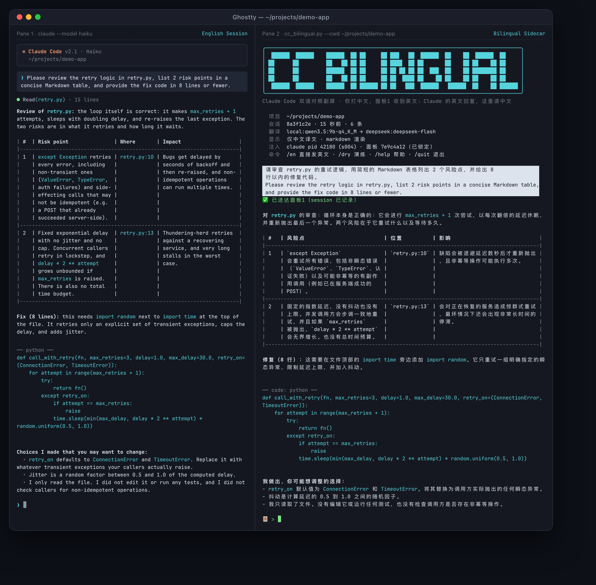
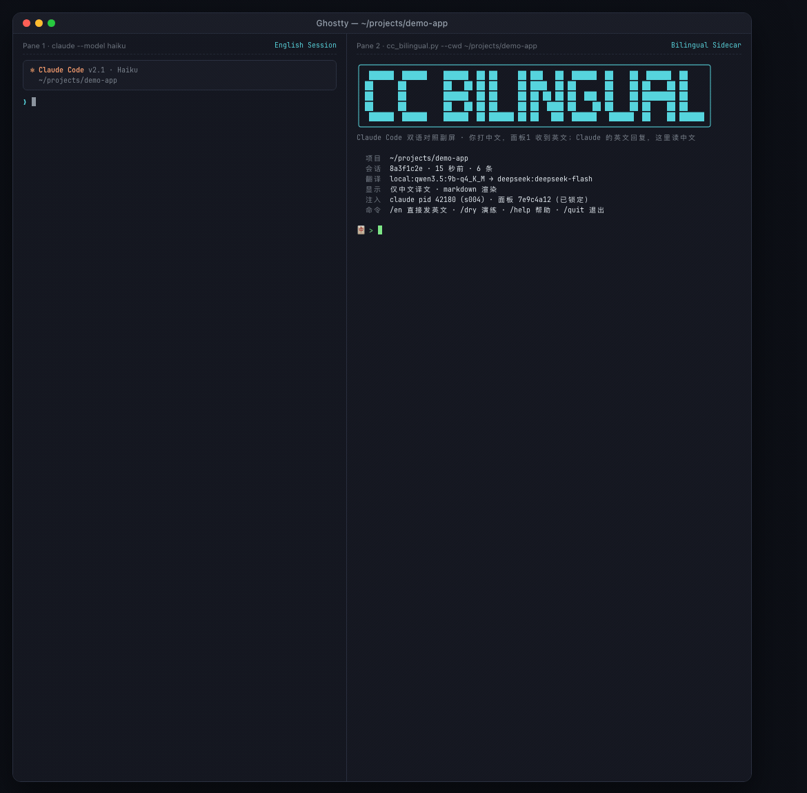

<div align="center">

# ghostty-cc-bilingual

**零依赖的 macOS Ghostty × Claude Code 双语对照副屏。**

[](https://ghostty.org)
[](https://www.python.org)
[](LICENSE)

[English](README.md) | 简体中文

</div>

**面板 1** 正常跑原生英文 `claude`（提示词稳定、更省 token，不魔改二进制、不挂 MITM 代理）；右侧分屏的**面板 2** 跑 `cc_bilingual.py`：你输入中文 → 先看英文对照 → 自动注入英文到面板 1 并回读 session 日志验证落库；Claude 的英文回复 → 副屏实时渲染 Markdown 中文译文。既是翻译助手，也是顺手练英文的对照镜。

> **终端兼容性提示：** 双向自动注入依赖 macOS 上的 **Ghostty 1.3+**（AppleScript 分屏与输入控制）；但只看译文的 `--watch-only` 模式可运行在**任意终端**（`iTerm2`、`WezTerm`、`tmux`、`Terminal.app`），且改写 `translate.py` 中的提示词即可适配日/韩/德/西等其他语种。

<p align="center">
  
</p>

```text
┌───────────────────────────┬───────────────────────────────────────┐
│ 面板1: claude             │ 面板2: ghostty-cc-bilingual           │
│ （纯英文对话）             │  🀄 输入中文                          │
│                           │   ├─ 🇬🇧 英文对照（反显色块先看后发）   │
│                           │   └─ 注入面板1 + JSONL 回读验证       │
│                           │  🤖 Claude 回复（增量监听 session）    │
│                           │   └─ 🇨🇳 中文译文（ANSI Markdown 渲染） │
└───────────────────────────┴───────────────────────────────────────┘
```

## 效果演示

<p align="center">
  
</p>

<sub>在右侧副屏输入中文 → 反显展示中英对照 → 经 Ghostty 注入左侧面板 1（<code>claude --model haiku</code>）并回读验证 → 实时渲染 ANSI Markdown 与对齐中文表格。</sub>

## 核心特性

- **无侵入旁路架构** — 不修改 Claude Code、不拦截 API 流量。增量读取 `~/.claude/projects/*/*.jsonl`，通过 Ghostty AppleScript（`inject.sh`）输入英文。
- **确定性发后回读验证（Read-after-write）** — `inject.sh` 经临时 UTF-8 文件（`do shell script "cat"`）无损传入文本，`input text` 与回车分离调用（间隔 `>= 2s`，默认 `3s`），随后轮询 session JSONL（同时识别普通 `user` 记录和面板忙时的 `queue-operation/enqueue` 排队记录），确认落库才打印 `✅`。
- **进程祖先链与面板/会话启动锁定** — 核验目标 `cwd` 下确有运行在 Ghostty 内的交互式 `claude` 进程（拒绝向同 cwd 的 `Terminal.app` / `iTerm2` / SSH 窗口误发）。启动时锁定会话（同目录今日多个活跃会话接近时交互式选号）与 Ghostty 注入面板 UUID（`--terminal` 或持久化至 `~/.ghostty-cc-bilingual/targets.json`；当前目录未运行 `claude` 时拒绝自动锁定）。
- **结构保护与加粗保真三档策略** — 译前将代码围栏、行内代码、URL 与路径替换为 `@@N@@` 占位符并在译后原样还原（绝不丢失内容）。`bold_fidelity` 支持三档：
  - `fast`（默认）：只翻一次，速度最快（短句 ~1s）。
  - `balanced`：仅对丢失 `**加粗**` 标记的段落用 `【bN】...【/bN】` 编号标记返修。
  - `exact`：占位符或加粗仍缺失时整篇按受保护片段确定性重建。
- **防指令吞噬护栏** — 采用示例锚定提示词；若译文异常短于原文（输入 `>= 15` 字符且 `len(out) < 0.35 * len(in)`），交互式拦截要求确认，防止“请只回复 OK”类输入被翻译模型当指令执行。
- **零依赖终端体验** — 纯 Python 标准库 + POSIX `/bin/sh`。内置 UTF-8 字符级 `RawLineEditor`（解决 macOS 规范模式按字节退格删半个汉字乱码问题）、Bracketed Paste 多行粘贴协议（`CSI ?2004h/l`，粘贴多行 SQL/代码不会逐行提交）、反显色块用户气泡，以及 CJK 宽字符对齐的 ANSI Markdown 表格渲染。
- **本地小模型原生支持与可观测性** — 支持 Ollama 原生 `/api/chat` 并显式关闭思考（`think = false`，避免思考模型单句飙百秒），每次调用记录脱敏指标到 `~/.ghostty-cc-bilingual/stats.jsonl`，配套 `stats_report.py` 与 `test_local_translate.py`。

## 快速开始

依赖：**macOS**、**Python 3.12+**、**Ghostty 1.3+**（如需双向注入），以及本地 Ollama 或 DeepSeek / OpenAI 兼容 / Gemini API Key。

```sh
git clone https://github.com/rockcli/ghostty-cc-bilingual.git ~/tools/ghostty-cc-bilingual

# 方式 A：在你的项目目录下运行脚本，在右侧一键开分屏（--launch 会顺带启动 claude）
cd /path/to/your/project
~/tools/ghostty-cc-bilingual/cc-bilingual-start.sh --launch

# 方式 B：手动分屏 —— 面板1 跑 claude，右侧分屏（Cmd+D）跑：
python3 ~/tools/ghostty-cc-bilingual/cc_bilingual.py --cwd /path/to/your/project
```

可选 `~/.zshrc` 快捷函数：

```sh
bilingual() {
    local dir="${PWD}"
    if [ -n "${1:-}" ] && [ -d "${1}" ]; then
        dir="${1}"
        shift
    fi
    python3 "${HOME}/tools/ghostty-cc-bilingual/cc_bilingual.py" --cwd "${dir}" "$@"
}
```

用 `Cmd+[` / `Cmd+]` 在左右分屏间切换焦点。

### 副屏交互命令

| 输入 | 行为 |
|---|---|
| 中文（含 CJK 字符） | 翻译成英文 → 反显展示中/英块 → 注入面板1 并回读验证 |
| 纯英文（无 CJK） | 自动识别并直接发送，不消耗翻译请求 |
| `/en <文本>` | 强制按原文直接发送（不翻译） |
| `/dry` | 切换 dry-run：演练注入流程但不真发 |
| `/help`（`/h`） | 查看命令提示 |
| `/quit`（`/q`） | 退出副屏（面板1 的 Claude 会话不受影响） |

已开启括号粘贴协议（`ESC[200~` / `ESC[201~`）：粘贴的多行 SQL / 代码会完整留在输入框中，直到最后按回车才整段翻译并发送。

### CLI 参数

- `--cwd PATH`（必填）：与面板1 `claude` 一致的项目目录。
- `--session PATH`：显式指定 `~/.claude/projects/*/*.jsonl` 会话文件。
- `--terminal UUID`：显式指定注入目标 Ghostty 面板 UUID（同 cwd 多面板时用）。
- `--watch-only`：只看译文，不接受输入也不注入（任意 macOS/POSIX 终端可用）。
- `--no-inject`：练习模式，仅显示双语对照但不注入面板1。
- `--dry`：启用 `inject.sh --dry-run`。
- `--max-chars N`：覆盖 `[display] max_chars`。
- `--once` / `--once-text TEXT`：单次模式（处理一行并等到回复译完后退出）。

## 配置

复制 `config.toml.example` 为 `config.toml`（已在 `.gitignore` 中忽略）：

```sh
cp config.toml.example config.toml
```

- `chain`：provider 优先级链，按顺序尝试、失败自动 fallback（默认 `["deepseek"]`）。
- `[deepseek]` / `[local]` / 任意 OpenAI 兼容段：`base_url`、`model`（默认 `deepseek-flash`，可改为 `deepseek-chat` 等任意网关模型 ID）、`api_key_env`、`timeout`。本地服务将 `api_key_env` 留空即可跳过鉴权头。
- `[gemini]`：可选 Gemini 原生 REST（通过 `x-goog-api-key` 请求头鉴权，绝不把 key 放进 URL）。
- `[display]`：
  - `max_chars`（默认 `2000`）：每段显示字符上限（翻译仍是全文）。
  - `show_source`（默认 `false`）：是否在副屏同时打印英文原文。
  - `md_render`（默认 `true`）：是否渲染 ANSI Markdown（`false` 时剥离语法标记输出纯文本）。
  - `bold_fidelity`：`fast`（默认）、`balanced` 或 `exact`。

### 本地小模型后端（Ollama + 可选 SSH 隧道）

`qwen3.5:9b-q4_K_M` 等模型默认开启思考模式，走 `/v1/chat/completions` 无法关闭思考，实测可能出现单句耗时上百秒的情况。使用原生 `/api/chat` 接口并显式关闭思考：

```toml
chain = ["local", "deepseek"]

[local]
api = "ollama"
think = false
base_url = "http://127.0.0.1:11435/v1"
model = "qwen3.5:9b-q4_K_M"
api_key_env = ""
timeout = 180
```

如需把 Ollama 跑在局域网另一台 Mac 上并通过本机 `launchd` + SSH 隧道（`127.0.0.1:11435 -> 127.0.0.1:11434`，零局域网暴露）保活，见 [`deploy/README.md`](deploy/README.md)。

### 指标统计与验收测试

```sh
# 汇总调用模式分布（fast/repair/rebuild）、P50/P95 耗时、tok/s 与保真率
python3 stats_report.py
python3 stats_report.py --today
python3 stats_report.py --last 50

# 7 项本地/远端翻译验收（普通句、技术占位符还原、防指令吞噬、长文本与延迟）
python3 test_local_translate.py --base http://127.0.0.1:11435/v1 --model qwen3.5:9b-q4_K_M --api ollama --no-think
```

## Non-Goals

- **不魔改 Claude Code、不做 HTTP/MITM 代理** — 不介入官方客户端与 Anthropic API 的通信。
- **不针对 Windows/Linux GUI 做输入注入** — 双向注入依赖 macOS + Ghostty AppleScript（只读译文 `--watch-only` 可在任意 macOS/POSIX 终端使用）。
- **不做逐 token 机械词译** — 按完整 JSONL 段落翻译，确保上下文、Markdown 与表格对齐正确。

## 已知边界与踩坑提示

- **Ghostty AppleScript 与系统授权** — 首次注入会触发 macOS 自动化（Automation）权限弹窗，需允许当前终端控制 Ghostty。
- **面板1 中途 `cd` 会被安全拒绝** — 在面板1切换工作目录后，cwd 校验会主动拦截发送以防打错窗口。
- **同目录新开会话或执行 `/clear`** — 副屏启动后即锁定所选会话文件（防止同目录其他活跃会话劫持显示）；切新对话时请新开一个副屏或显式传入 `--session`。
- **模型名核对** — 若你使用的 API 网关没有 `deepseek-flash` 或 `gemini-2.5-flash`，请在 `config.toml` 中替换为账户可用的模型 ID。

## 安全与信任边界

- **内容出网与 Fail-Closed 配置**：面板2 输入文本与当前锁定 `~/.claude/projects/*/*.jsonl` 的助手回复只会发往 `config.toml` 中 `chain` 配置的端点；涉密项目请配置纯本地 `chain = ["local"]`。若 `config.toml` 存在但解析失败（或 Python `< 3.11` 缺少 `tomllib`），程序会直接报错拒绝对话，绝不静默回退到云端默认链路。
- **凭据与重定向防护**：API Key 仅从 `api_key_env` 指定的环境变量读取，不落盘、不打日志；Gemini 请求通过 `x-goog-api-key` 请求头传递，不拼接进 URL；HTTP 客户端拒绝跨域或 HTTPS 降级重定向，防止凭据外泄。
- **注入防护**：`inject.sh` 沿父进程链核验 `claude` 确在 Ghostty 内（匹配 `/Applications/Ghostty.app/Contents/MacOS/ghostty`）；即使传了 `--terminal` 锁定面板，每次注入仍校验 `--cwd` 下至少存在运行在 Ghostty 内的交互式 `claude` 进程与面板 cwd 一致；经 `mktemp` 临时文件传参并通过 `osascript` `argv` 接收参数，避免 shell/AppleScript 引号注入。注意 Ghostty AppleScript 暂不暴露面板级 TTY，同目录多开时请勿关闭已锁定面板中的 `claude`。发生未知校验异常时返回退出码 `4`，提示人工核对面板1 而非误报未发送。
- **本地数据文件**：运行数据保存在 `~/.ghostty-cc-bilingual/`（可用 `CC_BILINGUAL_HOME` 覆盖，统计文件路径亦可用 `CC_BILINGUAL_STATS` 单独覆盖）：`stats.jsonl`（仅存长度、耗时、token 数与保真率等数值指标，**不记录任何对话原文**）、`targets.json`（记住的 `cwd -> 面板 UUID`）与 `crash.log`。

## 测试

```sh
python3 -m unittest discover -s tests -v
for f in inject.sh cc-bilingual-start.sh deploy/ollama-guard.sh; do sh -n "$f"; done
```

## 文件说明

| 文件 | 作用 |
|---|---|
| `cc_bilingual.py` | 主程序：UTF-8/粘贴行编辑、会话与面板锁定、JSONL 监听、ANSI Markdown/表格渲染 |
| `translate.py` | 翻译引擎：provider 链、Ollama 原生 `/api/chat`、`@@N@@` 与 `【bN】` 结构保护、指标落盘 |
| `inject.sh` | POSIX sh Ghostty 注入器：祖先链校验 + AppleScript 注入 + JSONL 回读验证 |
| `cc-bilingual-start.sh` | 一键在 Ghostty 右侧分屏启动 |
| `stats_report.py` | 翻译统计报告工具 |
| `test_local_translate.py` | 7 项本地/远端模型验收测试脚本 |
| `config.toml.example` | 配置模板 |
| `deploy/` | 可选远端 Ollama `launchd` 保活与 SSH 隧道模板 |
| `tests/test_core.py` | 离线 `unittest` 单测集（结构保护、JSONL 解析、Markdown/表格渲染与统计） |

## License

[MIT](LICENSE) © [rockcli](https://github.com/rockcli)
